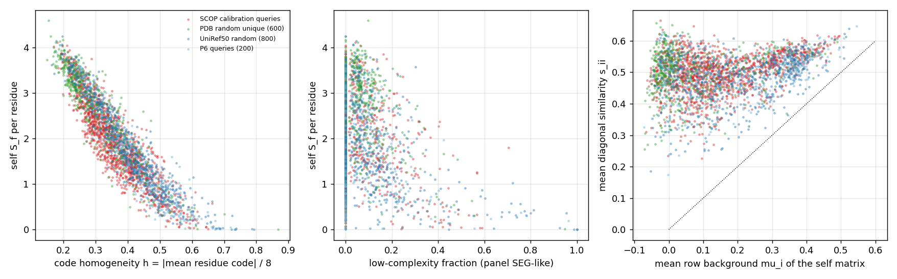
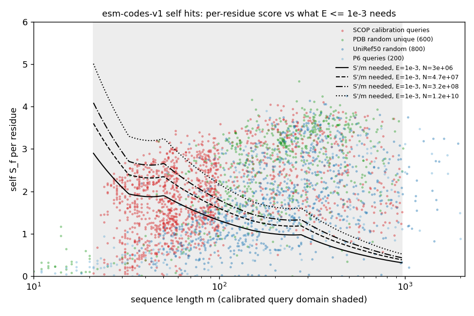
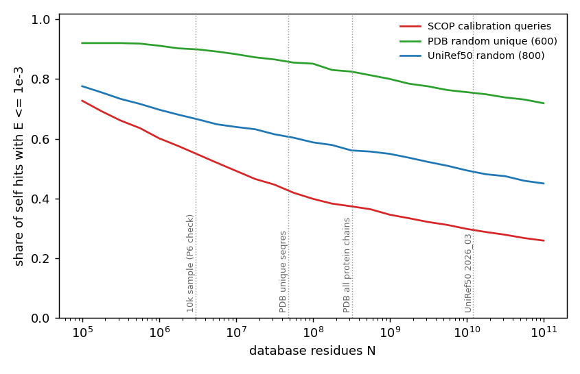

# esm-codes-v1: why self hits of short and "low-complexity" sequences get weak E-values

Date: 2026-10-19. Read-only study: no FoldMatch code and no part of the frozen `esm-codes-v1` system was changed.
FoldMatch was used read-only from the P6 sandbox tree (`wt-P6`, `a9584eb`). Scripts: this folder (`run_all.sh` lists
the commands). Data products (encodings, scores): `/Users/joan/devel/foldmatch-p2p3-sandbox/work/selfhit_data/`.
Full tables: `results/tables.md`; numbers: `results/results.json`, `results/v2probe_summary{,_filtered}.json`;
figures: `results/figs/`.

## 1. Answer

**Cause.** A self hit is weak when the protein's residue codes are all alike. The rowcol z of S7 standardises every
pair against its own row and column means. When most residues of a protein encode the same thing, the true partner of
residue i barely stands out from the rest of its own row, so the diagonal's z, and with it `S_f`, is small.
- The diagonal similarity itself is the same for every protein (s_ii ≈ 0.50); what varies is the row background μ_i
  (0.01 to 0.34).
- One number captures it: the **code homogeneity** h = |mean residue code| / 8. It has Spearman ρ = −0.95 with the
  per-residue self score, and explains 74 % of the variance of ln(S_f/m). All sequence features together (length,
  low complexity, disorder, entropy, annotation, cluster size) explain 57 %; length alone 21 %.
- The relation is the same curve for SCOP domains, PDB chains and UniRef50 sequences (figure F2). The populations
  differ only in how many homogeneous proteins they contain.

**Not the cause.**
- The reversed-query subtraction S_r costs 0.1-0.8 nats (group medians).
- The panel shift Q90 costs 0.1-1.9 nats.
- Dropping either one, or both, would lift 1 of the 99 P6 self hits over E ≤ 1e-3.
- The λ/lnK clamp below 32.6 aa: extrapolating it in ln m instead changes none.

**Second, independent factor: short queries.** λ(m)·m grows slowly with m, so a short query needs a high
per-residue score to beat its search space. For E ≤ 1e-3:

| query length | S'/m needed, 10k sample | S'/m needed, UniRef50 |
|---|---|---|
| 21-50 aa | 1.9 | 3.2 |
| 101-200 aa | 1.1 | 1.8 |
| 301-600 aa | 0.7 | 1.1 |

A typical protein gives 1.5-3 per residue. So even well-folded SCOP calibration domains of 21-100 aa reach
E ≤ 1e-3 against themselves only 37 % of the time at 10k size, and 5 % at UniRef50 size.

**Who is affected.** Homogeneous codes are typical of:
- uncharacterised and orphan UniRef50 sequences: singletons are 64 % of the 10k database, and 77 % of the
  "uncharacterized" ones are in the top homogeneity tertile;
- short sequences: 80 % of 21-100 aa entries are in the top tertile;
- some low-complexity or disordered sequences.

Sequence low complexity itself is a weak predictor (ρ = −0.19). The 12 weakest P6 self hits are proteins of 21-91 aa
with h = 0.52-0.72; 10 of them are "uncharacterized", and nine have no low-complexity window at all. Fragment status hardly
matters (ρ = −0.07). The 10k UniRef50 database is uniform over clusters, so it is far more homogeneous (median h
0.406) than the calibration panel (0.316), the SCOP calibration queries (0.349) or PDB (0.281). That is why the P6
check saw so many weak self hits. PDB behaves well: 86 % of random unique PDB chains of 21-966 aa reach E ≤ 1e-3
against themselves at PDB size, and 91-99 % above 100 aa.

**Recommendation.**
- **v1: document it, change nothing.** The self hit is still ranked first (99/100 in P6).
- **Use BLOSUM62 for identity and close-homolog searches.** A self hit carries 0.17-0.6 bits per residue under
  esm-codes against 2.1 under BLOSUM62.
- **Do not use "self hit at E ≤ 1e-3" as a P8 acceptance criterion.** Use "self hit ranked first".
- **For v2,** the probe (§6) supports an amino-acid term next to the embedding term, as Foldseek's 3Di+AA does
  (candidate C2). It would need its own calibration, a low-complexity safeguard and a sensitivity benchmark first.
  A pair-independent "background z" (C1) is not recommended.

## 2. Data and method

| set | what | n (21-966 aa) |
|---|---|---|
| P6 check | job 60008416 outputs `E_inf`, `B_inf` (10k UniRef50 database, N = 2,957,247; 100 in-database queries) | 99 self hits |
| `u50_q200` | the 200 P6 queries (length-stratified, 100 in the database) | 180 |
| `u50_db800` | 800 random entries of the 10k database (uniform over UniRef50 2026_03 clusters ≤ 2,000 aa) | 777 |
| `scop_q` | the 1,431 unique SCOP benchmark queries λ/K were calibrated on | 1,431 |
| `pdb_r600` | 600 of the P0.6 census's 2,000 uniform random unique PDB seqres protein sequences | 566 |

- **Encodings.** Each sequence was encoded by FoldMatch's own path: `esm_open` and `per_residue_embedding`, then the
  registered esm-codes-v1 head, on MPS. Both the query encoding and the target code were kept, so each sequence can
  be scored against itself.
- **Scoring.** FoldMatch's kernel (`swkern.score_fwd_rev`, `align`) gave the self S_f and S_r and the panel Q90 over
  the shipped 1,000 members. The registry table gave λ/lnK, and `code_statistics` the E arithmetic.
- **Diagnostics.** The self matrix was recomputed in float64 for per-residue diagnostics. Sequence features were
  computed with the panel strata's own definitions: low-complexity fraction (12-residue windows below 2.2 bits) and
  TOP-IDP.
- **Check against P6.**
  - **S_f.** For the 99 P6 self hits, the local S_f is within 0.24 % median (max 5 %) of the CUDA run. With the
    database's stored codes it is within 0.04 %.
  - **Q90.** Within 0.018 median.
  - **Codes.** MPS codes match the CUDA database codes at 99.78 % of bits, as in P5.
  - **E column.** The S11 arithmetic reproduces P6's E column.
  - **SCOP query encodings.** They match the archived research encodings (median row cosine 0.99997).

**What the development phase measured (context from the main session).**
- **Self hits were never tested before P6.** No MMseqs2 benchmark query is in its own target set; this study found 3
  of 1,465 by sequence. The panel excluded sequences overlapping the evaluation sets. The alignment work measured F1
  against US-align, not E-values.
- **The system was already known to be conservative at small E.** Benchmark sensitivity at E ≤ 1e-3 (same SCOP
  family) was 0.152 / 0.196 on the two validation halves. The null alignment is about 19 residues long.
- **The P0.6 census saw the same effect from the null side.** Queries under 21 aa had 0 hits at E ≤ 1 where chance
  predicted about 4,000. It was read then as "conservative". It is the same limit as §4.3 here: too little score
  per query to leave the null.

## 3. Decomposition of the P6 self hits

ln E = [lnK(m) + ln m + ln N] − λ(m)·S_f + λ(m)·S_r + λ(m)·Q90, at N = 2,957,247. Medians, in nats:

| m | n | S_f/m | λ | λ·S_f | λ·S_r | λ·Q90 | search space | S'/m needed (E ≤ 1e-3) | E ≤ 1e-3 | without S_r | without Q90 | without both | λ extrapolated < 32.6 aa |
|---|---|---|---|---|---|---|---|---|---|---|---|---|---|
| < 21 | 5 | 0.20 | 0.188 | 0.6 | 0.13 | 0.06 | 4.3 | 3.51 | 0/5 | 0 | 0 | 0 | 0 |
| 21-100 | 37 | 0.51 | 0.136 | 3.1 | 0.25 | 0.24 | 4.9 | 1.88 | 3/37 | 3 | 3 | 3 | 3 |
| 101-300 | 25 | 1.31 | 0.074 | 14.5 | 0.50 | 1.06 | 6.2 | 1.03 | 13/25 | 14 | 14 | 14 | 13 |
| 301-966 | 27 | 2.20 | 0.043 | 54.2 | 0.68 | 1.87 | 5.7 | 0.55 | 27/27 | 27 | 27 | 27 | 27 |
| > 966 | 5 | 2.44 | 0.042 | 142.0 | 0.82 | 1.71 | 6.3 | 0.23 | 5/5 | 5 | 5 | 5 | 5 |

What this shows:
- E ≤ 1e-3 needs λ·S' ≥ search space + 6.9 nats. A 21-100 aa self hit brings a median 3.1 nats of signal against
  the 11.8 it needs.
- The two subtractions are small. S_r/S_f is 0.016-0.07 in every group, including the most repetitive: the
  reversed query is a poor null for itself, as the research encode README noted. Q90 is lowest for exactly the weak
  self hits (7.6 in the top homogeneity tertile, 32 in the bottom one).
- BLOSUM62 found all 99 of these self hits, 93 of them at E ≤ 1e-10 (88 of 89 in 21-966 aa, P6 report).

**How much the reversed query takes from low-complexity self scores.** S = S_f − S_r was adopted to cancel
composition-driven scores. All 2,954 local self hits of 21-966 aa, by the panel's low-complexity fraction:

| low-complexity fraction | n | S_r/S_f median (P90) | λ·S_r median (P90), nats | self hits that dropping S_r lifts over E ≤ 1e-3 (10k / UniRef50 size) |
|---|---|---|---|---|
| 0 | 1,740 | 0.033 (0.055) | 0.53 (0.78) | 44 / 27 |
| (0, 0.1] | 587 | 0.014 (0.025) | 0.62 (0.85) | 2 / 2 |
| (0.1, 0.3] | 498 | 0.026 (0.053) | 0.53 (0.84) | 9 / 10 |
| (0.3, 0.6] | 102 | 0.054 (0.18) | 0.34 (0.74) | 2 / 1 |
| > 0.6 | 27 | 0.091 (0.86) | 0.25 (0.59) | 0 / 0 |
| all | 2,954 | 0.028 (0.055) | 0.54 (0.80) | 57 / 40 (1.9 % / 1.4 %) |

- **For the most low-complexity sequences, S_r can cancel most of the self score.** In the > 0.6 group the P90 of
  S_r/S_f is 0.86. But their S_f is already tiny, and S_r is worth only 0.25 nats.
- **The S_r cost is small and mostly hits ordinary sequences.** The 57 self hits that S_r keeps above 1e-3 are near
  the threshold, and 44 of them have no low-complexity window at all.
- **The reversed query is not what weakens low-complexity self hits.** Their forward score is low before anything
  is subtracted.

## 4. What makes the per-residue self score small

### 4.1 The mechanism: homogeneous codes, not a weak diagonal

Self matrix of each protein, medians over proteins (21-966 aa, all four populations pooled). The groups are the
tertiles of h.

| h tertile | n | median m | S_f/m | h | s_ii | μ_i (self row) | μ_i^P (panel) | σ_i | z_ii | z_ii^P | residues out-scored in own row |
|---|---|---|---|---|---|---|---|---|---|---|---|
| ≤ 0.309 | 985 | 203 | 3.07 | 0.260 | 0.516 | 0.012 | 0.004 | 0.128 | 4.07 | 3.76 | 9 % |
| 0.309-0.409 | 984 | 114 | 2.00 | 0.356 | 0.485 | 0.133 | 0.061 | 0.140 | 3.00 | 2.62 | 32 % |
| > 0.409 | 985 | 91 | 1.03 | 0.472 | 0.513 | 0.322 | 0.121 | 0.169 | 2.02 | 2.32 | 68 % |

Column meanings:
- s_ii = cos(q_i, d_i), the diagonal similarity.
- μ_i, σ_i = row mean and standard deviation of the self matrix (S7).
- μ_i^P = mean similarity of residue i to the panel's 355,626 codes.
- z_ii^P = the diagonal standardised against that fixed panel background.

What the table shows:
- The diagonal is equally strong everywhere; it is the background that rises.
- In the top tertile, 68 % of residues have some other residue of their own protein that out-scores their true
  partner.
- The homogeneity is mostly the protein's own. Against the panel's codes the same residues have μ_i^P = 0.12, not
  0.32, so a pair-independent standardisation would keep more of the diagonal (z_ii^P 2.32 against z_ii 2.02). But
  μ_i^P is still raised: these query encodings also lean towards the codes of proteins in general (§6).

Spearman correlation with S_f/m (UniRef50, 1,000 sequences, 21-966 aa):

| feature | ρ |
|---|---|
| **code homogeneity h** | **−0.95** |
| row background μ_i | −0.86 |
| share of residues out-scored in their own row | −0.86 |
| μ_i^P (panel background) | −0.80 |
| "uncharacterized" in the name | −0.55 |
| length (ln m) | +0.54 |
| composition entropy | +0.52 |
| UniRef50 cluster size n | +0.34 |
| TOP-IDP disorder | −0.20 |
| low-complexity fraction | −0.19 |
| BLOSUM62 internal repeat score | +0.15 |
| fragment | −0.07 |
| diagonal similarity s_ii | +0.07 |

Variance of ln(S_f/m) explained by least squares:

| predictors | R² |
|---|---|
| h | 0.74 |
| h + length | 0.76 |
| length | 0.21 |
| sequence features only (ln m, low complexity, TOP-IDP, entropy, uncharacterized, ln n) | 0.57 |
| everything | 0.82 |

*F2. Left: per-residue self score against code homogeneity, one curve for all populations. Middle: against the
low-complexity fraction, weak. Right: the diagonal similarity s_ii stays near 0.5 while the row background μ_i varies.*

### 4.2 Which sequences have homogeneous codes

Share of each group of the 10k database (21-966 aa, 9,617 entries) in the top h tertile (h > 0.409):

| group | share of database | median h | h > 0.409 |
|---|---|---|---|
| singleton clusters (n = 1) | 64 % | 0.427 | 57 % |
| clusters n 2-9 | 30 % | 0.376 | 37 % |
| clusters n ≥ 10 | 7 % | 0.318 | 25 % |
| "uncharacterized" | 38 % | 0.469 | 77 % |
| annotated | 62 % | 0.358 | 31 % |
| 21-100 aa | 20 % | 0.480 | 80 % |
| 101-300 aa | 49 % | 0.403 | 48 % |
| 301-966 aa | 31 % | 0.356 | 31 % |

Per population:

| population | median h | h > 0.409 |
|---|---|---|
| 10k UniRef50 database | 0.406 | 49 % |
| the shipped panel (n-weighted UniRef50) | 0.316 | 24 % |
| SCOP calibration queries | 0.349 | 29 % |
| PDB unique | 0.281 | 15 % |

The same link appears inside the panel's own strata (`shipped_panel.tsv`, codes only):

| panel stratum | median h | h > 0.409 |
|---|---|---|
| low-complexity fraction > 0.1 | 0.381 | 40 % |
| low-complexity fraction 0 | 0.306 | 23 % |
| low-complexity fraction (0, 0.1] | 0.287 | 13 % |
| disordered (D2) | 0.379 | 37 % |
| ordered (D0) | 0.302 | 20 % |
| 30-134 aa | 0.428 | 60 % |
| ≥ 700 aa | 0.336 | 27 % |

So the panel does include homogeneous members, and Q90 is computed against them.

The weakest P6 self hits (21-966 aa; E from P6):

| id | m | name | E | S_f/m | h | low-complexity fraction | μ_i | z_ii |
|---|---|---|---|---|---|---|---|---|
| UniRef50_A0A4V3D5N2 | 34 | Uncharacterized protein | 150 | 0.00 | 0.67 | 0.00 | 0.45 | 0.73 |
| UniRef50_A0A509EDP0 | 67 | Uncharacterized protein | 150 | 0.06 | 0.66 | 0.00 | 0.49 | 0.97 |
| UniRef50_A0A518B6S0 | 52 | Uncharacterized protein | 120 | 0.05 | 0.72 | 0.00 | 0.50 | 0.68 |
| UniRef50_A0ABZ1TTB4 | 54 | Uncharacterized protein | 62 | 0.20 | 0.67 | 0.96 | 0.55 | 1.18 |
| UniRef50_A0AAV4H412 | 91 | Uncharacterized protein | 49 | 0.24 | 0.62 | 0.63 | 0.40 | 1.09 |
| UniRef50_A0AAU9ENM7 | 46 | ATP synthase F0 subunit 8 | 47 | 0.24 | 0.63 | 0.37 | 0.51 | 1.23 |
| UniRef50_D7FVL5 (strongest) | 715 | UTP-glucose-1-phosphate uridylyltransferase | 3.6e-37 | 3.14 | 0.31 | 0.15 | −0.01 | 4.14 |

- In the first three rows `S_f` is near 0: their diagonal cells sit at or below the SW offset (z_ii < 1). Under
  esm-codes these proteins carry no evidence that they are themselves rather than any other protein.
- Low complexity in sequence, as the P6 report put it, is one route to homogeneous codes, not the main one. ESM3
  gives near-uniform embeddings along chains it has little evolutionary context for: orphans, short ORFs and
  uncharacterised predictions.

### 4.3 Short queries, independently of h

S'/m needed for E ≤ 1e-3, and the share of self hits that reach it (local recomputation):

| m | S'/m needed (10k) | S'/m needed (UniRef50) | SCOP: E ≤ 1e-3, 10k / PDB / UniRef50 | PDB: same | UniRef50 random: same |
|---|---|---|---|---|---|
| 21-50 | 1.9 | 3.2 | 18 / 2 / 0 % | 11 / 5 / 0 % | 0 / 0 / 0 % |
| 51-100 | 1.5 | 2.5-2.6 | 49 / 33 / 8 % | 46 / 33 / 12 % | 14 / 7 / 1 % |
| 101-200 | 1.1 | 1.8 | 95 / 90 / 75 % | 94 / 85 / 63 % | 61 / 51 / 32 % |
| 201-300 | 1.0 | 1.6 | 99 / 97 / 88 % | 99 / 98 / 95 % | 88 / 82 / 62 % |
| 301-600 | 0.7 | 1.1-1.2 | 99 / 99 / 94 % | 99 / 99 / 97 % | 94 / 93 / 87 % |

- **The calibration is not wrong here.** λ(m) for short queries is calibrated on SCOP nulls. Short queries simply
  have little room: m·λ(m) is 6 nats at 32 aa against 25 at 595 aa.
- **The clamp below 32.6 aa is not the issue.** It is conservative; extrapolating it changed no P6 decision.

*F1. Per-residue self score against length, with the per-residue S' needed for E ≤ 1e-3 at four database sizes.*

## 5. Database size

E is proportional to N: every factor of 10 in N costs 2.3 nats. Share of self hits with E ≤ 1e-3:

| population | m | 10k sample (3.0e6) | PDB unique (4.7e7) | PDB all chains (3.2e8) | UniRef50 (1.2e10) |
|---|---|---|---|---|---|
| UniRef50 random | 21-100 | 12 % | 6 % | 3 % | 1 % |
| UniRef50 random | 101-300 | 71 % | 63 % | 54 % | 43 % |
| UniRef50 random | 301-966 | 94 % | 93 % | 92 % | 88 % |
| UniRef50 random | all 21-966 | 67 % | 61 % | 56 % | 49 % |
| SCOP calibration queries | all 21-966 | 55 % | 43 % | 37 % | 29 % |
| PDB random unique | 21-100 | 36 % | 25 % | 18 % | 9 % |
| PDB random unique | 101-300 | 96 % | 91 % | 86 % | 77 % |
| PDB random unique | all 21-966 | 90 % | 86 % | 82 % | 76 % |

How the sizes were set:
- **PDB unique.** 187,064 sequences × 253.8 aa mean length (the census's uniform random sample).
- **UniRef50.** All 38,840,027 representatives, 1.218e10 residues (P0.6 census).
- **The P6 check.** It ran at the smallest of these sizes. A UniRef50-sized esm-codes database would report about
  half of its random members' self hits at the default `--max-evalue 1e-3`.

Information per residue of a self hit (bits/m; BLOSUM62 = full-length self score under FoldMatch's 11/1
Karlin-Altschul parameters):

| population | m | esm-codes-v1 | BLOSUM62 | E ≤ 1e-3 at UniRef50 size, esm-codes / BLOSUM62 |
|---|---|---|---|---|
| UniRef50 random | 21-100 | 0.42 | 2.11 | 1 % / 100 % |
| UniRef50 random | 101-300 | 0.28 | 2.08 | 43 % / 100 % |
| UniRef50 random | 301-966 | 0.18 | 2.06 | 88 % / 100 % |
| PDB random unique | 101-300 | 0.35 | 2.09 | 77 % / 100 % |

esm-codes E-values measure embedding similarity beyond a per-pair background. They give no credit for amino-acid
identity as such. That is what makes them sensitive to remote homologs (P6: held-out queries got 16/100 hits at
E ≤ 1e-3, BLOSUM62 got 0), and it is also why an identical sequence earns only 0.2-0.6 bits per residue.

*F3. Share of self hits at E ≤ 1e-3 as the database grows.*

## 6. FUTURE WORK probe: would another cell score fix it, and at what false-positive cost?

*Not part of esm-codes-v1. The probe is a quick feasibility check to steer a future system, not a calibration.*

**Set-up** (`v2probe.py`, `blosum_null.py`; 1,000 queries of 21-966 aa: 400 UniRef50, 300 SCOP calibration
queries, 300 PDB).
- **Scoring.** Every query is scored against itself, the shipped 1,000-member panel (Q90) and 300 random 10k-database
  entries as the null (84,109 residues; none of them a query). Each candidate uses the same setting D (offset 1, gaps
  5/0.5) and the same S = S_f − S_r, S' = S − Q90.
- **V1 check.** V1 in the probe reproduces FoldMatch's kernel: self S_f relative difference ≤ 1.1e-6, Q90 ≤ 3e-5.
- **Calibration.** Each candidate gets its own mini-recalibration: an exponential tail above the pooled 99th
  percentile of null S', in the system's six length bins. False-positive ratio = null pairs at E ≤ t / (t × queries).
- **Homolog filter.** Random UniRef50 pairs include unlabelled homologs. The 185 null pairs that BLOSUM62 already
  calls homologous (E ≤ 0.01, 117 queries; about 10 expected by chance) were removed. Remote homologs remain, and
  they are counted as false positives.

The candidate cell scores:

| candidate | cell score | idea |
|---|---|---|
| V1 | per-pair rowcol z − 1 | esm-codes-v1 |
| C1 | 0.5((s − μ_i^P)/σ_i^P + (s − ν_j^B)/τ_j^B) − 1 | "background z": standardise against fixed backgrounds (panel codes for rows, 800 UniRef50 query encodings for columns), so a protein's own homogeneity is not subtracted |
| C2, κ = 0.1 / 0.2 | V1 + κ·BLOSUM62(a_i, b_j) | an amino-acid term next to the embedding term, as Foldseek's 3Di+AA |

**Results** (null with BLOSUM62 homologs removed). The h tertiles are ≤ 0.303, 0.303-0.402 and > 0.402. Self
shares use each candidate's own refit.

| | V1 | C1 | C2 κ=0.1 | C2 κ=0.2 |
|---|---|---|---|---|
| FP ratio at E ≤ 1 / 0.1, all 1,000 queries | 0.79 / 1.99 | 0.76 / 2.05 | 0.79 / 1.98 | 0.79 / 2.00 |
| FP ratio, h top tertile | 0.14 / 0.33 | 0.15 / 0.24 | 0.14 / 0.33 | 0.15 / 0.33 |
| FP ratio, h bottom tertile | 1.42 / 3.72 | 1.37 / 4.14 | 1.43 / 3.72 | 1.43 / 3.69 |
| FP ratio, low-complexity fraction > 0.1 (237) / > 0.3 (45) | 0.60 / 0.11 at E ≤ 1 | 0.58 / 0.07 | 0.59 / 0.11 | 0.61 / 0.11 |
| self E ≤ 1e-3 at 10k size, all | 54 % | 56 % | 71 % | **85 %** |
| same, h top tertile | 13 % | 10 % | 34 % | **61 %** |
| self E ≤ 1e-3 at UniRef50 size, all | 18 % | 21 % | 31 % | **48 %** |
| same, h top tertile | 2 % | 1 % | 6 % | 13 % |
| median self S'/m, h top tertile | 1.01 | 1.06 | 1.50 | 1.98 |

How to read it:
- **The FP pattern is the same for every candidate.** Neither the background z nor the amino-acid term (κ ≤ 0.2)
  makes the null tail of homogeneous or low-complexity queries heavier than V1 does. Every group's FP ratio is
  within the counting noise of V1's. The low-complexity check is weak, though: random targets rarely share a query's
  low-complexity composition, and that is exactly where an amino-acid term is risky (the classic BLAST case). A real
  v2 needs a targeted low-complexity null (low-complexity queries against low-complexity targets) and a safeguard:
  SEG-mask the amino-acid term, or composition-correct it.
- **C1 does not help** (54 → 56 %). Standardising against a fixed background keeps more of the diagonal, but the
  null rises with it: these query encodings also lean towards generic codes (μ_i^P is raised, §4.1).
- **C2 helps in proportion to κ.**
  - It doubles the per-residue self score of the most homogeneous tertile.
  - It lifts the share of self hits at E ≤ 1e-3 from 54 to 85 % at 10k size, and from 18 to 48 % at UniRef50 size.
  - These gains are relative to V1 under the same refit.
- **Absolute numbers here are pessimistic.** The refit λ for the long bins is 2-3 times smaller than the
  shipped table's (0.015 against 0.042 at ≥ 406 aa), because remote homologs among random UniRef50 pairs fatten the
  tail. Under the shipped table, the same 1,000 queries reach 72 % (10k) and 54 % (UniRef50) with V1.
- **Not measured here:** remote-homology sensitivity and alignment quality. These were the reasons for v1's design.
  For homologs below about 20 % identity, the amino-acid term is mostly noise: for κ = 0.2, about −0.2 mean and 0.4
  SD per cell, next to a z of SD 1. Some loss at the remote end is possible and must be measured on the SCOP
  benchmark (sensitivity at 1e-3, SW F1 against US-align) before any choice.

**Side observation on v1 calibration (not this study's question).** With the shipped table, these random UniRef50
nulls give FP ratios of 1.47 / 4.5 / 22 at E ≤ 1 / 0.1 / 0.01 (filtered).
- **By group.** Bottom h tertile 2.6 / 8.7 / 41; top h tertile 0.41 / 0.84 / 5.7.
- **Likely cause.** The excess sits in the well-folded, family-rich queries that are most likely to have remote
  homologs among random UniRef50 clusters. 12 % of the queries had a BLOSUM62-detectable homolog among only 300
  random targets.
- **What it means.** The excess is an upper bound, not evidence of miscalibration. The SCOP-labelled P0 validation
  stays the calibration evidence. Homogeneous queries are, if anything, scored conservatively: their weak self hits
  are not offset by weak nulls.
- **P8.** A homology-labelled production null (A5 on chains or AFDB, open since the research) would settle the small-E
  end.

## 7. Recommendation

### 7.1 v1: document it, change nothing

No defect was found. The behaviour follows from the method's per-pair background removal and the calibrated
length-dependent λ. Changing it would mean a new system (principle 2).

**P9 documentation (method page and `--scoring` help), suggested text:**

> **Self hits and near-identical sequences.** esm-codes E-values measure how far an alignment's ESM3 embedding
> similarity rises above what the same two proteins share with everything else. They give no credit for amino-acid
> identity as such. Most proteins find themselves at very small E-values. A protein whose ESM3 residue embeddings
> are nearly uniform along the chain, however, finds itself only weakly: the hit is still ranked first, but its
> E-value can exceed the default `--max-evalue 1e-3`, and then it is not reported. Such proteins are mostly short
> sequences, uncharacterised or orphan predicted proteins, and some low-complexity or disordered sequences. Short
> queries also need a high per-residue score: under 100 residues even folded domains often stay above 1e-3 against
> themselves. E grows in proportion to the database size.
>
> In a random sample of UniRef50 sequences of 21-966 residues, 67 % reach E ≤ 1e-3 against themselves in a
> 3-million-residue database and 49 % at full UniRef50 size (12 % and 1 % for 21-100 residues). For PDB chains the
> figure is 86 % at PDB size. For identity or close-homolog searches use `--scoring blosum62`. Under esm-codes, raise
> `--max-evalue` (for example to 10) to list weak self or near-identical hits.

**P8 (A8, real pipeline).**
- Expect this behaviour: do not use "self hit at E ≤ 1e-3" as an acceptance criterion under esm-codes. Use "self
  hit ranked first when Stage 1 returns it" (99/100 in P6). Report Stage-1 recall (1/100 missed by HNSW) separately.
- Breaking self-hit E down by h or length makes the expected pattern visible. `bgprobe.py` computes h from codes
  alone.

### 7.2 v2 candidates (FUTURE WORK; each is a new system name with its own calibration)

In order of expected value:

1. **Amino-acid term (C2-like), recommended to study.**
   - **What it does.** Self and close-homolog hits gain the most: in the probe, self hits at E ≤ 1e-3 rose from 54 to
     85 % at 10k size and from 18 to 48 % at UniRef50 size, with κ = 0.2.
   - **FP control.** On random UniRef50 nulls the false-positive pattern was unchanged after its own recalibration.
   - **Needed first.**
     - A new panel Q90 and λ/K fit: the full M3t999 on the SCOP benchmark, plus the A5 checks.
     - A low-complexity safeguard for the amino-acid term (SEG mask or composition correction), tested on a
       low-complexity-vs-low-complexity null.
     - The SCOP remote-homology sensitivity and alignment-F1 comparison against v1.
   - **Cost.** κ is one more tuned number. The kernel needs the amino-acid sequences in Stage 2, which FoldMatch
     already reads.
2. **Encoder-side fix.**
   - **Idea.** Train or regularise the encoders so that residue codes keep per-residue information when ESM3's
     embedding is dominated by a protein-wide component. For example, remove the per-protein mean before f_t/f_q, or
     add a self-alignment or identity term to the loss.
   - **Expected effect.** It attacks the cause (h), but changes the codes, so every database must be rebuilt, and the
     effect on remote homology is unknown.
   - **Untested.** The 16-byte models (`L2m_B16_*`) were not checked for lower homogeneity; that is a cheap first
     look.
3. **Background standardisation (C1): not recommended.** No self-hit gain in the probe.
4. **Shorter-query statistics: no change recommended.** The λ(m) clamp below 32.6 aa is not the limit. Short
   queries are limited by the information they carry, which only a richer score (1 or 2) can raise.
5. **Outside the scoring system (no new system name needed): an exact-identity shortcut.**
   - **Idea.** Report database entries whose `seq_sha1` equals the query's, with a flag, whatever their E-value.
   - **What it covers.** The "find myself" use case, without touching E-values.
   - **What it does not cover.** Near-identical sequences.
   - **Where it belongs.** A FoldMatch feature, not a v2 scoring change.

## 8. Limits of this study

- **Encodings.** They were computed on MPS (fp32 ESM3), not on CUDA (bf16 autocast). Agreement with P6 is in §2. The
  population numbers have sampling error of a few points: 777 UniRef50, 566 PDB, 1,431 SCOP.
- **Composition features.** "Uncharacterized", "fragment" and the cluster size come from UniRef50 representative
  names: proxies, not curated annotations. Code homogeneity h is a description of the codes, not a mechanism inside
  ESM3. The "uniform embedding" reading (orphans, short ORFs) is an interpretation.
- **The probe's calibration.** It is a pooled-tail refit on 1,000 queries × 300 random UniRef50 targets, with
  BLOSUM62-detectable homologs removed and no homology labels. It compares candidates on the same pairs; it does not
  calibrate any of them.
